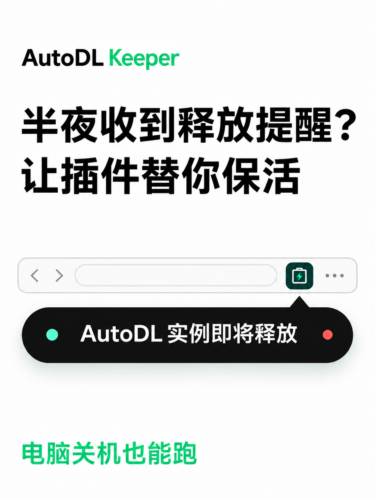
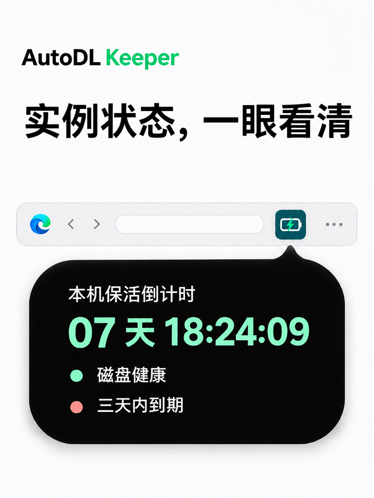
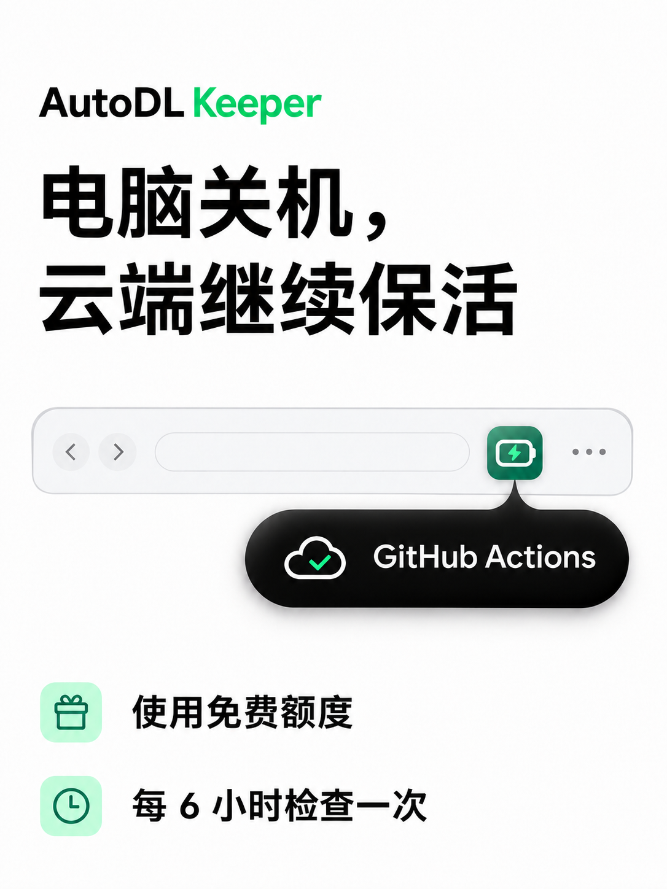
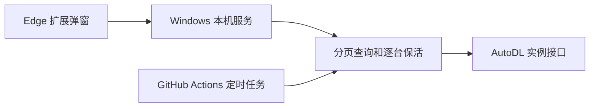

# AutoDL Keeper

**在 Edge 查看 AutoDL 实例，在 GitHub Actions 自动保活。**

半夜收到实例释放提醒时，可以把「无卡开机、等运行、再关机」这套流程交给 AutoDL Keeper。Edge 弹窗用来查看实例和手动操作，云端工作流可以在你的电脑关机时继续执行。

**[下载 Windows + Edge 安装包 ZIP](https://github.com/austinbf/autodl-keeper/releases/download/v1.3.0/AutoDL-Keeper-1.3.0.zip)** · [查看版本发布页](https://github.com/austinbf/autodl-keeper/releases/tag/v1.3.0)

<details>
<summary>查看三张功能示意图</summary>





</details>

## 一、安装 Edge 扩展

### 1. 下载安装包

推荐下载上面的 Release ZIP，解压并保留整个 `AutoDL-Keeper` 文件夹。也可以用 Git 克隆仓库：

```powershell
git clone https://github.com/austinbf/autodl-keeper.git
cd autodl-keeper
```

### 2. 启动本机服务

需要 Windows、Microsoft Edge 和 Python 3.12。在解压目录或克隆目录里打开 PowerShell。首次执行时创建环境并安装依赖：

```powershell
py -3.12 -m venv .venv
.\.venv\Scripts\python.exe -m pip install -r requirements.txt
```

启动服务，看到本机地址 `http://127.0.0.1:8765` 后保留 PowerShell 窗口：

```powershell
.\.venv\Scripts\python.exe keeper_web.py
```

### 3. 加载扩展

1. 在 Edge 地址栏打开 `edge://extensions/`。
2. 开启「开发人员模式」，点击「加载解压缩的扩展」。
3. 选中项目内的 **`edge_extension` 文件夹**。该目录里应有 `manifest.json`。
4. 在工具栏的扩展菜单里找到 **AutoDL Keeper**，点击固定图标，方便以后打开。

## 二、配置令牌和试运行

### 1. 获取 AutoDL 网页令牌

1. 登录 AutoDL 网页并打开实例列表。
2. 按 **F12** 打开开发人员工具，切到「网络」面板，再刷新实例列表。
3. 找到发往 `www.autodl.com` 的实例列表请求，通常是 `POST /api/v1/instance`。
4. 打开「标头」，在「请求标头」里复制 `authorization` 的值。令牌可以操作你的实例，请只填入扩展设置或 GitHub Actions Secret。

### 2. 在弹窗里设置

点击工具栏图标，打开左下角「设置」，粘贴令牌并点击「保存设置」。返回首页后，可以查看实例状态、磁盘健康和到期提醒。

建议先勾选一台闲置且已关机的实例，点击「手动开关机」并确认。日志会在运行时展开，完成后收起。看到「已确认关机」才表示这一轮结束。

> 只想用 GitHub Actions 自动保活时，可以从一开始就取消勾选「启用本机自动保活」。扩展仍可用来查询状态和手动操作。

## 三、设置自动保活

| 方式 | 检查规则 | 电脑关机时 |
| --- | --- | --- |
| GitHub Actions | 每 6 小时检查一次，处理连续关机满 8 天或距预计释放不超过 72 小时的实例 | 云端继续运行 |
| Windows 本机 | 每 8 天执行一次，并每 15 分钟检查是否需要提前保活 | 本机服务恢复后补跑错过的定时批次 |

### 方式 A · GitHub Actions 云端保活

1. 把项目放在你有写权限的 GitHub 仓库。确认默认分支包含 [云端工作流](.github/workflows/AutoDL-Keeper.yml)。
2. 进入仓库的 **Settings → Secrets and variables → Actions → New repository secret**。名称填 `AUTHORIZATION`，值填 AutoDL 网页令牌。
3. 打开 **Actions → AutoDL Keeper → Run workflow**。首次保留「仅检查实例和保活条件」勾选。日志应显示查到几台实例、几台符合保活条件。
4. 检查成功后，建议关闭扩展里的本机自动保活，避免重复操作。云端运行历史在 GitHub Actions 查看。

云端检查可以使用 GitHub Actions 免费额度。AutoDL 无卡开机仍按平台规则计费。GitHub 的定时触发可能延迟，公开仓库连续 60 天无活动时，定时工作流也可能被停用。 [GitHub 定时任务说明](https://docs.github.com/en/actions/reference/workflows-and-actions/events-that-trigger-workflows#schedule)

### 方式 B · Windows 本机保活

在弹窗「设置」勾选「启用本机自动保活」并保存。首页会显示下次本机保活倒计时。关闭 Edge 后，只要本机服务还在运行，计划就能继续执行。

如需 Windows 登录后自动启动服务，在项目根目录运行：

```powershell
.\enable_keeper_startup.ps1
```

这会注册名为 `AutoDL Keeper` 的 Windows 计划任务。电脑关机期间无法执行本机保活。

## 四、常见问题

### 弹窗提示「无法连接本机服务」或「请求来源无效」

先确认 `keeper_web.py` 正在运行。升级后，关闭旧服务，再从新版目录启动，然后进入 `edge://extensions/` 重新加载扩展。加载目录应为 `edge_extension`。

### 保存令牌后查询失败

重新登录 AutoDL，从实例列表请求获取新的 `authorization`。本机令牌使用当前 Windows 用户的 DPAPI 加密保存。「清除令牌」只影响本机。使用云端保活时，还需要在 GitHub 单独更新 `AUTHORIZATION`。

### GitHub Actions 成功运行，但没有开机

手动启动时默认「仅检查」。此模式只查询实例和保活条件。定时运行也只会处理达到保活条件且已关机的实例，正在训练的机器会跳过。

### 标红意味着什么？开关机能延期吗？

弹窗会标红距预计释放、租期到期或主机下架不超过 72 小时的实例。无卡开关机用于刷新连续关机的释放计时。租期到期和主机下架需要在 AutoDL 另行处理。

### 为什么弹窗和 GitHub 的执行记录不同？

弹窗倒计时和日志来自本机服务。GitHub 云端执行由仓库的 Actions 页面记录。

## 五、工作原理



保活流程会先检查实例是否关机，再请求无卡开机。确认以无卡模式运行后发起关机，等到实例回到关机状态，再处理下一台。

| 文件 | 用途 |
| --- | --- |
| [edge_extension/](edge_extension/) | Manifest V3 扩展与工具栏弹窗 |
| [keeper_web.py](keeper_web.py)、[keeper_schedule.py](keeper_schedule.py) | 本机接口、凭据和调度 |
| [autodl/](autodl/)、[keeper_plugin.py](keeper_plugin.py) | AutoDL 接口、分页、实例健康与电源操作 |
| [keeper_actions.py](keeper_actions.py)、[AutoDL-Keeper.yml](.github/workflows/AutoDL-Keeper.yml) | 云端任务入口和定时工作流 |
